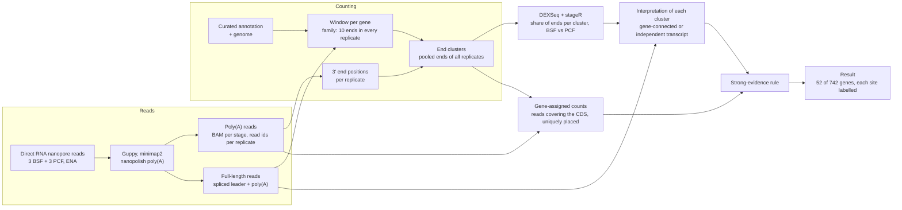
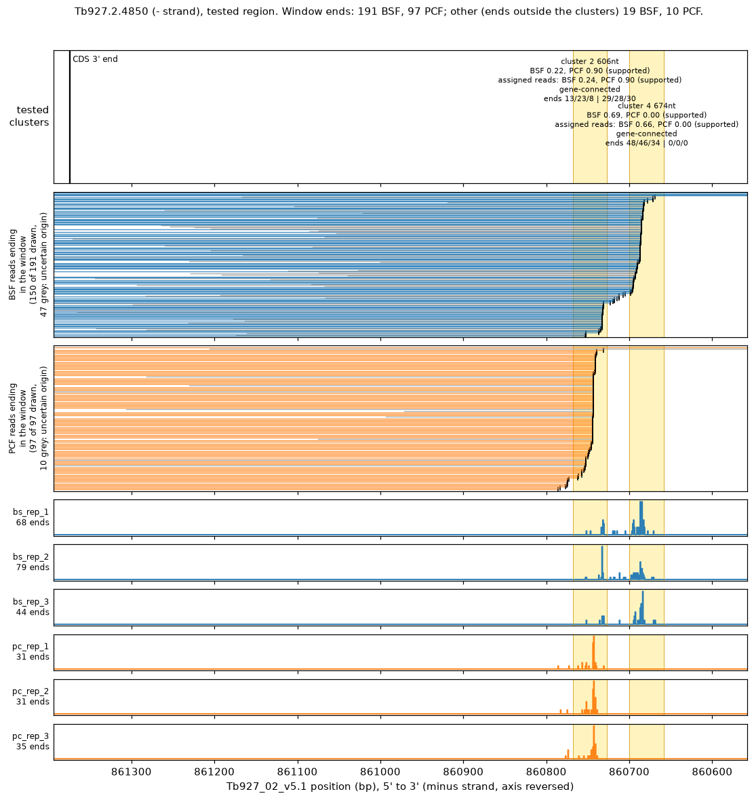

# Alternative 3' ends of *T. brucei* genes between life stages

Code and data for the analysis of differential poly(A) site usage between
bloodstream-form (BSF) and procyclic-form (PCF) *Trypanosoma brucei*, from
direct RNA nanopore sequencing, three replicates per stage.

The question: for each gene, do its transcripts end at a different place in
the two life stages? A nanopore read of a poly(A)-tailed RNA ends where the
molecule was polyadenylated, so the 3' ends of the reads map the poly(A)
sites a gene uses. We count, for every gene, how its read ends are shared
among its sites in each replicate, and test whether the shares differ
between stages.

**Result: among 742 adequately measured genes, 52 show strong evidence of a
different 3' end between BSF and PCF.** All 52 are found again with a second
definition of the counting window, and 50 of them under every tested
read-assignment rule. The gene list is `expected/strong_end_usage_nanopore.tsv`
and the figures of the 52 genes are in `docs/figures/index_strong.html`.

## How the analysis works



1. **Where the reads end.** Each read with a measured poly(A) tail gives one
   3' end position. For every gene we take the span from its coding sequence
   to the end of the longest full-length read (a read that carries both the
   spliced leader and the poly(A) tail, so it is a whole transcript). A gene
   enters the analysis when every replicate has at least 10 read ends in that
   span: 2891 genes.
2. **Grouping the ends into sites.** Read ends scatter over a few bases
   around a site. The ends of all six replicates are pooled and grouped into
   clusters without looking at the stage, so the sites are the same for both
   stages and cannot be shaped by the comparison. A cluster counts when it
   holds at least 5 ends in two replicates; a gene is tested when it has two
   or more such clusters.
3. **Testing the change.** For each gene, the share of ends in each cluster
   is compared between stages with DEXSeq, a model built for changes in the
   relative usage of parts of a gene, with the replicates as the unit of
   variation. stageR then controls the error at the gene level: 230 genes are
   supported at a gene-level overall false discovery rate of 5 percent.
4. **Reading each site.** A site downstream of a gene can belong to a
   separate transcript, not to the gene. For every supported cluster the
   reads ending in it are examined: those whose 5' end is known tell whether
   they started at the gene (gene-connected) or at an independent transcript
   (transcript-associated), or both (mixed). Independent transcripts are
   catalogued from the full-length reads and get their own abundance test.
5. **Counting the gene's own reads.** The test of step 3 compares a cluster
   with everything else in the window, and the window can hold ends of other
   transcripts. The count is therefore repeated with only the reads assigned
   to the gene: reads that cover its coding sequence, placed uniquely on the
   genome and covering no other gene. Same clusters, same model. A gene is
   flagged when a cluster moves by 30 or more points of usage, every
   replicate of one stage lies above every replicate of the other, the same
   cluster moves the same way under two other cluster definitions, and at
   least 20 of the gene's own reads end there. 52 of the 742 genes measured
   well enough for this count pass.

`docs/methods.md` gives every step with its parameters.

## Results

| Analysis | Genes measured | Supported (stageR, OFDR 5 %) | Strong evidence |
|---|---|---|---|
| Window counts, nanopore windows (primary) | 2891 in the family, 1197 testable | 230 | |
| Window counts, intergenic windows (sensitivity) | 3182, 1503 testable | 352 | |
| Gene-assigned counts, nanopore windows (primary) | 742 eligible | 138 | **52** |
| Gene-assigned counts, intergenic windows (sensitivity) | 762 eligible | 147 | 54 (the 52 and two more) |

Of the 52 genes, 34 use the flagged site more in PCF and 18 more in BSF; in
2 the site lies inside the coding sequence. The 388 supported clusters of the
window analysis read as 291 gene-connected, 39 mixed, 5 transcript-associated
and 53 unresolved. Of 68 independent transcripts with enough full-length
reads, 16 change in abundance between stages.

Sensitivity of the 52 to the read-assignment rule (nanopore windows, the
whole chain refitted each time):

| Mapping quality required | Secondary-alignment rule | Eligible | Strong evidence |
|---|---|---|---|
| 1 | yes | 789 | 52 |
| 10 | yes | 753 | 51 |
| 20 (primary) | yes | 742 | 52 |
| 30 | yes | 739 | 52 |
| 60 | yes | 710 | 52 |
| 20 | no | 745 | 52 |

The complete tables are in `expected/` and the summary written by the run is
`expected/RESULTS_v2.md`.



*Tb927.2.4850, tested region. Top: the two end clusters with their usage per
stage. Middle: the reads ending in the window, BSF then PCF, with their 3'
ends marked. Bottom: end counts per replicate. The second cluster holds 24 %
of the gene's ends in BSF and 90 % in PCF.*

## Reproduce the analysis

You need [Docker](https://docs.docker.com/get-docker/), about 6 GB of disk
space and the four alignment files from the Zenodo data archive (2.8 GB).
On Apple silicon, Docker runs the image in x86-64 emulation, which is
slower but gives the same results.

1. Get the repository and the alignment files:

   ```
   git clone https://github.com/mtinti/tbrucei_alternative_3end_paper.git
   cd tbrucei_alternative_3end_paper
   # copy the four .bam files and their .bai indexes from the Zenodo record into data/bam/
   ```

2. Build the image (about 10 minutes, once):

   ```
   docker build --platform linux/amd64 -t alternative-3end .
   ```

3. Run everything (about 40 minutes with 4 threads):

   ```
   docker run --rm --platform linux/amd64 -v "$PWD":/work alternative-3end make all
   ```

`make all` checks the input checksums, decompresses the inputs, runs the
analysis without figures and compares the tables with the published ones.
Each check prints `OK` or `FAIL`. The tables are written to `results/`:

| Output | Content |
|---|---|
| `results/docs/strong_end_usage_nanopore.tsv`, `_intergenic.tsv` | One row per eligible gene: the flag, the qualifying cluster, usage per stage, the change, the reasons when the gene is not flagged |
| `results/docs/mapq_sensitivity_nanopore.tsv` | The flagged set under every read-assignment rule |
| `results/docs/events_nanopore.tsv`, `_intergenic.tsv` | One row per supported cluster of the window analysis with its evidence and label |
| `results/docs/ranked_*.tsv`, `support_by_setting_*.tsv` | Ranking of the supported genes; support under every setting and model |
| `results/docs/transcript_catalogue.tsv`, `transcript_abundance.tsv` | The independent transcripts and their abundance test |
| `results/docs/RESULTS_v2.md` | The summary, every number from the saved tables |
| `results/docs/run_manifest*.json` | Inputs with checksums, options, software versions, outputs with checksums |

`make figures` runs the analysis again with the figures and the two HTML
indexes (about 2 hours). To run a single stage, replace `make all` with
`make check-data`, `make inputs`, `make analysis` or `make verify`.

### What "reproduced" means here

The analysis has no random step. `make verify` requires the family, the
supported genes of both analyses, the eligible genes, the flagged genes with
their qualifying cluster and change, and the sensitivity table to be
identical to the published ones in `expected/`. The published run and its
software versions are recorded in `expected/run_manifest.json`.

## Repository contents

```
data/            input data, with checksums and a description of each file (data/README.md)
scripts/         one script per step, numbered in the order they run, and verify.py
upstream/        how the inputs were made from the raw reads on the cluster
expected/        the published tables, the summary and the run manifests used by the checks
docs/            methods, the figures of the flagged genes, index_strong.html
run_analysis.sh  the steps in order, called by the Makefile
Dockerfile       the environment
Makefile         the commands run by make all
```

## Raw data and large files

| Data | Repository | Accession |
|---|---|---|
| Direct RNA nanopore reads, 6 runs | European Nucleotide Archive | ERR10957780 to ERR10957785 (`upstream/README.md` maps runs to replicates) |
| Alignment files (4 BAM), complete results of one run, figures of every supported gene | Zenodo | (to be assigned) |

`scripts/make_zenodo_archive.sh` builds the Zenodo data archive from a
complete run.

## Citation

- Tinti M. tbrucei_alternative_3end_paper: code and data for the analysis of
  alternative 3' end usage between *Trypanosoma brucei* life stages from
  direct RNA nanopore sequencing. Zenodo (DOI to be assigned).

`CITATION.cff` has the same information in machine-readable form.

## License

Code: MIT (`LICENSE`). Data in `data/` and `expected/`: CC BY 4.0
(`data/LICENSE`).

## Contact

Michele Tinti is responsible for the data and code. Please open a GitHub
issue for questions.
